<!-- Header banner -->

  

  

  
  
  

---

### 🧑‍💻 About Me

Mobile dev by day, full-stack tinkerer by night! 🚀 I love experimenting with new tools to make life better, and I write about my journey to make tech a little easier for everyone — or to chase the next big thing.

- 📱 Building native apps with **Swift** and **Kotlin**
- ⚙️ Backend adventures with **Spring**, **Go** and **Node.js**
- 📝 I regularly write articles on **[lordgift.in.th](https://lordgift.in.th)** — you can support me by clicking on the ads 😋
- 💬 Ask me about **iOS, Android, Java, or anything DevOps**

---

### 🛠️ Tech Stack

| | |
|:--|:--|
| **📱 Mobile** | <a href="https://www.swift.org" title="Swift">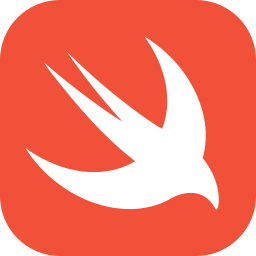</a>&ensp;<a href="https://developer.apple.com/xcode/" title="Xcode">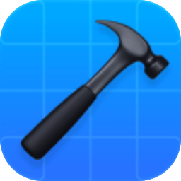</a>&ensp;<a href="https://kotlinlang.org" title="Kotlin">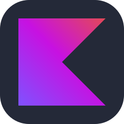</a>&ensp;<a href="https://developer.android.com/studio" title="Android Studio">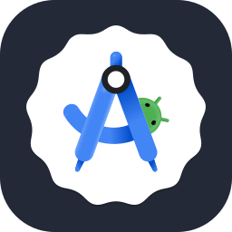</a>&ensp; |
| **⚙️ Backend** | &ensp;&ensp;&ensp;&ensp;&ensp;&ensp;&ensp;<a href="https://www.ruby-lang.org" title="Ruby">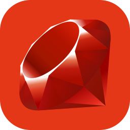</a>&ensp;&ensp;<a href="https://laravel.com" title="Laravel">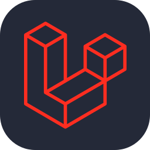</a> |
| **🌐 Frontend** | &ensp;&ensp;&ensp;<a href="https://www.figma.com" title="Figma">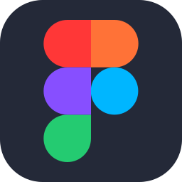</a> |
| **🗄️ Data & Messaging** | &ensp;&ensp;&ensp;&ensp; |
| **☁️ Cloud & DevOps** | <a href="https://firebase.google.com" title="Firebase">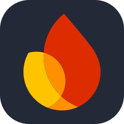</a>&ensp;<a href="https://cloud.google.com" title="Google Cloud">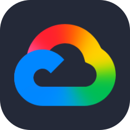</a>&ensp;&ensp;&ensp;&ensp;&ensp; |
| **🧰 Tools & Fun** | <a href="https://www.jetbrains.com/idea/" title="IntelliJ IDEA">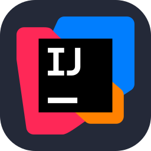</a>&ensp;&ensp;<a href="https://pubs.opengroup.org/onlinepubs/9799919799/basedefs/V1_chap09.html" title="Regular Expressions">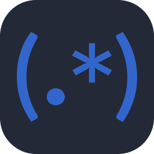</a>&ensp;<a href="https://www.arduino.cc" title="Arduino">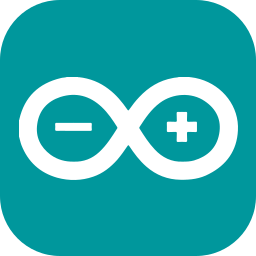</a> |

---

### 🏅 Certifications

---

### 📊 GitHub Stats

  <picture>
    <source media="(prefers-color-scheme: dark)" srcset="https://github-readme-stats-fast.vercel.app/api?username=lordgift&show_icons=true&theme=tokyonight&hide_border=true&bg_color=00000000">
    
  </picture>
  <picture>
    <source media="(prefers-color-scheme: dark)" srcset="https://github-readme-stats-fast.vercel.app/api/top-langs/?username=lordgift&layout=compact&theme=tokyonight&hide_border=true&bg_color=00000000">
    
  </picture>

  <picture>
    <source media="(prefers-color-scheme: dark)" srcset="https://github-readme-stats-fast.vercel.app/api/streak?username=lordgift&theme=tokyonight&hide_border=true">
    
  </picture>

---

### 🐍 Contribution Snake

  <picture>
    <source media="(prefers-color-scheme: dark)" srcset="https://raw.githubusercontent.com/lordgift/lordgift/output/github-contribution-grid-snake-dark.svg">
    <source media="(prefers-color-scheme: light)" srcset="https://raw.githubusercontent.com/lordgift/lordgift/output/github-contribution-grid-snake.svg">
    
  </picture>

<!-- _generated with [Platane/snk](https://github.com/Platane/snk)_ !-->

<!-- Footer banner -->

  

